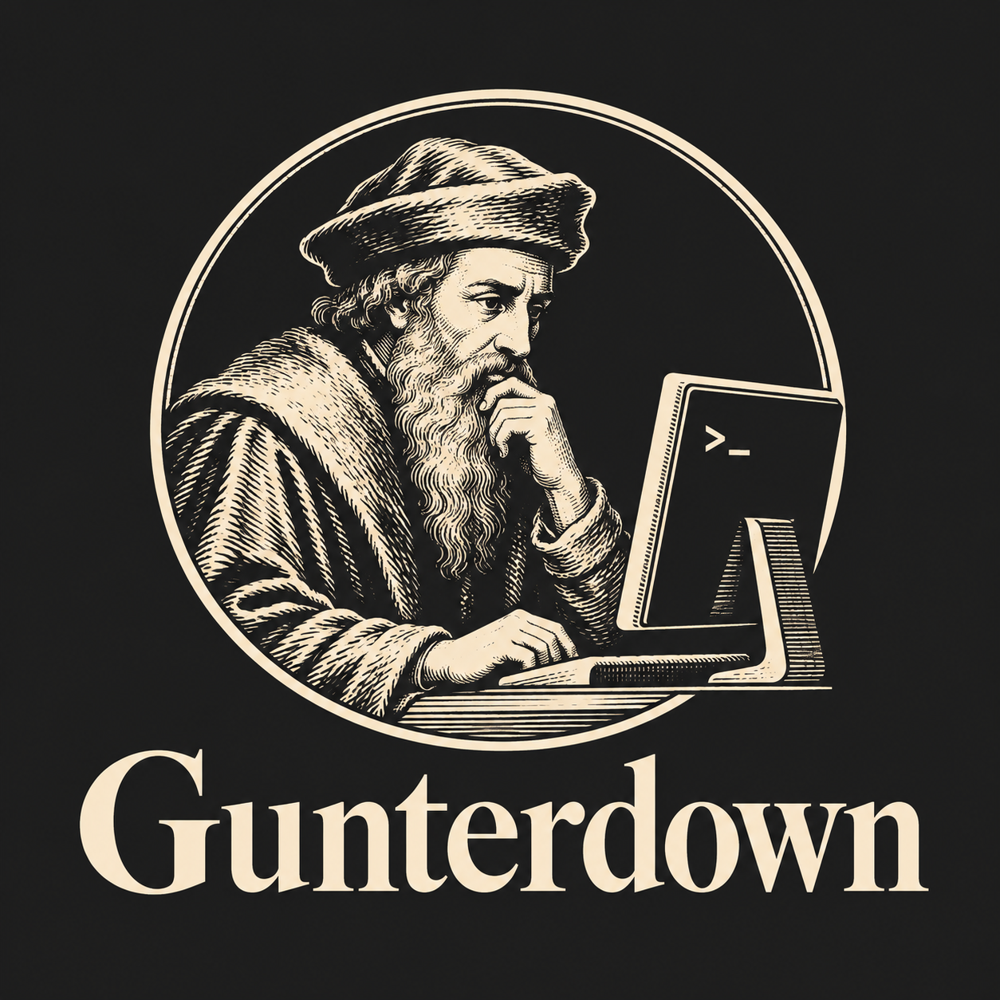

<p align="center">
  
</p>

<h1 align="center">Gunterdown</h1>

<p align="center">
  Un éditeur Markdown multilingue, directement dans votre terminal.<br>
  Écrit en Python, utilisable hors ligne, sans dépendance Python externe.
</p>

<p align="center">
  <a href="#démarrage-rapide">Démarrer</a> ·
  <a href="#installation">Installer</a> ·
  <a href="USAGE.md">Manuel</a> ·
  <a href="CONTRIBUER.md">Contribuer</a>
</p>

## Écrire sans quitter le terminal

Conçu par Zeima pour rédiger des articles, Gunterdown réunit l’édition Markdown,
les modèles d’article et l’autocomplétion en **français, anglais, japonais,
chinois simplifié et coréen**. L’interface et le manuel intégré sont également
proposés dans ces cinq langues.

- **Édition** : coloration Markdown, annuler/rétablir, sélection avec
  Shift+flèches, presse-papiers interne, indentation et retour à la ligne visuel.
- **Documents** : arborescence, plusieurs buffers, fichiers récents, recherche
  et remplacement avec expressions régulières, recherche dans les fichiers.
- **Articles** : modèles avec front-matter, sommaire, structures Markdown et
  vérification des liens internes et des blocs ouverts.
- **Aide à la rédaction** : dictionnaires embarqués, détection de langue par
  paragraphe et suggestions près du curseur.
- **Personnalisation** : sept thèmes, langue d’interface indépendante de la
  langue de rédaction et raccourcis configurables.
- **Enregistrement** : sauvegarde atomique et récupération après incident.
- **Export** : HTML autonome intégré ; EPUB et PDF avec des outils facultatifs.

## Démarrage rapide

Il vous faut **Python 3.9 ou plus récent avec `curses`**, ainsi qu’un terminal
**UTF-8**, sous Linux, macOS, BSD ou WSL.

Depuis le dépôt :

```sh
./gunterdown
./gunterdown mon_article.md
```

Autre lanceur disponible : `python3 bin/gunterdown.py mon_article.md`.
Aucun paquet Python supplémentaire n’est nécessaire.

### Un premier lancement à votre rythme

Avant la création du fichier de configuration, un menu propose trois entrées :

| Choix                    | Comportement                                                                                                            |
| ------------------------ | ----------------------------------------------------------------------------------------------------------------------- |
| **Configurer**           | Choisir la langue de l’interface, la langue du document et du dictionnaire, puis le comportement des modèles d’article. |
| **Configuration rapide** | Enregistrer les réglages par défaut et continuer.                                                                       |
| **Lancer directement**   | Ouvrir l’éditeur et configurer plus tard, sans demande d’insertion de modèle.                                           |

Utilisez **↑ / ↓**, puis **Entrée** pour choisir. **Échap** permet aussi de
lancer directement. Le parcours reste accessible dans
**F2 → Outils → Préférences → Configurer**.
Une fois la configuration enregistrée, les lancements suivants ouvrent
l’éditeur directement. L’option `--new` conserve sa demande explicite de modèle.

### Les touches essentielles

| Action                           | Raccourci |
| -------------------------------- | --------- |
| Enregistrer                      | `Ctrl+S`  |
| Quitter                          | `Ctrl+X`  |
| Ouvrir les menus                 | `F2`      |
| Lire le manuel                   | `F1`      |
| Ouvrir un fichier                | `Ctrl+O`  |
| Changer de buffer                | `Alt+B`   |
| Rechercher                       | `Ctrl+W`  |
| Insérer un modèle d’article      | `Alt+T`   |
| Choisir la langue de rédaction   | `Alt+L`   |
| Choisir la langue de l’interface | `Alt+U`   |
| Changer de thème                 | `Alt+Y`   |

Tous les raccourcis sont décrits dans le [manuel d’utilisation](USAGE.md),
également accessible avec `F1` ; `Alt+H` affiche leur liste.

## Installation

### Installer la commande

```sh
./install.sh
```

Le script installe `gunterdown` dans `~/.local/bin` et ses ressources dans
`~/.local/share/gunterdown`. Ajoutez `~/.local/bin` à votre `PATH` si nécessaire.
L’installation est isolée et le script refuse une installation déjà présente.

Un autre préfixe peut être choisi :

```sh
./install.sh /chemin/vers/un/prefixe
```

Pour désinstaller l’installation par défaut :

```sh
~/.local/share/gunterdown/uninstall.sh ~/.local
```

Pour un préfixe personnalisé, utilisez son script
`<prefixe>/share/gunterdown/uninstall.sh <prefixe>`.
La désinstallation demande confirmation et conserve la configuration utilisateur.

### Construire une distribution

```sh
make build
./dist/gunterdown mon_article.md

# Installer le wheel produit
python3 -m pip install dist/gunterdown-0.7.0-py3-none-any.whl

# Construire un paquet Debian (nécessite dpkg-deb)
make build-deb
```

`make build` fonctionne hors ligne et produit une archive Python exécutable,
un wheel et une archive source dans `dist/`. Le fichier `dist/gunterdown`
embarque le code, les dictionnaires et le manuel ; la machine qui l’exécute
reste tenue de disposer de Python 3.9+ et de `curses`.

L’installation avec `python3 -m pip install .` est aussi possible et utilise
setuptools pour construire le paquet. Ces commandes ne publient rien sur
PyPI, AUR ou Homebrew.

### Outils facultatifs

| Outil             | Fonction                                              |
| ----------------- | ----------------------------------------------------- |
| Pandoc            | Export EPUB et import de fichiers org/rst, notamment. |
| Pandoc et XeLaTeX | Export PDF.                                           |
| Aspell            | Liste des mots inconnus en français et en anglais.    |

Ces outils ne sont pas installés par les scripts. L’édition, l’autocomplétion
et l’export HTML intégré fonctionnent sans eux.

## Langues et autocomplétion

La langue de l’interface et celle de la rédaction se règlent séparément :

```sh
# Interface anglaise, rédaction anglaise
./gunterdown --ui-lang en --lang en article.md

# Interface française, rédaction japonaise
./gunterdown --ui-lang fr --lang ja article.md

# Désactiver certains dictionnaires
./gunterdown --no-lang ja,zh,ko article.md

# Créer un article avec un modèle
./gunterdown --new article.md
```

En session, **Alt+U** change et enregistre la langue de l’interface ;
**Alt+L** choisit la langue d’autocomplétion ou la détection automatique.
La langue choisie dans le parcours de configuration sert de référence pour
les paragraphes dont la langue est ambiguë.

Les suggestions apparaissent près du curseur : jusqu’à cinq mots, classés
par fréquence, après **3 lettres latines**, **2 caractères japonais ou coréens**,
ou **1 caractère chinois**. **↑ / ↓** ou **Shift+Tab** change la sélection,
**Tab** valide et **Échap** ferme la liste. **Entrée** insère une nouvelle ligne.

La complétion préserve les majuscules et fonctionne aussi dans les phrases
japonaises ou chinoises sans espaces. En français et en anglais, elle propose
également des corrections de frappe marquées `↺`, par exemple
`bonjoru` → `bonjour`. Cette aide lexicale n’effectue pas d’analyse grammaticale.
Les dictionnaires issus de sous-titres contiennent aussi des noms et des
formes familières.

Pour le japonais, le chinois et le coréen, utilisez votre méthode de saisie
système : Gunterdown complète les caractères déjà saisis. Pour un texte
composé uniquement de caractères Han, **Alt+L** permet de lever l’ambiguïté
entre japonais et chinois.

L’autocomplétion fonctionne **hors ligne, sans transmission du texte saisi**.

## Configuration et thèmes

Les réglages sont conservés dans `~/.config/gunterdown/config.json`, créé
lors de la configuration initiale ou à la première sortie normale.
Le menu **Outils → Préférences** donne accès au parcours de configuration,
à la langue de l’interface et aux thèmes.

**Alt+Y** ouvre les thèmes avec aperçu immédiat : sombre classique, clair
papier, Solarized sombre, Nord boréal, Dracula violet, océan bleu et contraste
élevé. **Entrée** applique et enregistre ; **Échap** restaure le thème précédent.

```sh
./gunterdown --theme nord article.md
./gunterdown --no-color article.md
./gunterdown --diagnostics
```

Les palettes s’adaptent aux terminaux 256, 16 ou 8 couleurs. Les thèmes
personnalisés se placent dans `~/.config/gunterdown/themes/`.

| Réglage                     | Utilité                                                                        |
| --------------------------- | ------------------------------------------------------------------------------ |
| `ui.language`               | Langue de l’interface : `fr`, `en`, `ja`, `zh` ou `ko`.                        |
| `editor.default_lang`       | Langue de repli pour la détection automatique.                                 |
| `editor.auto_save_interval` | Intervalle d’enregistrement automatique ; `0` le désactive, valeur par défaut. |
| `template.auto_insert`      | Insertion du modèle : `ask`, `always` ou `never`.                              |
| `template.path`             | Chemin d’un modèle d’article personnalisé.                                     |
| `template.author`           | Auteur utilisé dans les modèles.                                               |

`GUNTERDOWN_HOME` change le répertoire de configuration, des logs et de
récupération. `GUNTERDOWN_LANG` définit la langue d’autocomplétion au démarrage ;
`--lang` est prioritaire. `GUNTERDOWN_NO_COLOR=1` désactive les couleurs.
Un fichier `keymap.json` dans le répertoire de configuration permet de modifier
les raccourcis, par exemple `{"save": "Alt+1"}` ; les conflits sont rejetés.

Les documents modifiés font l’objet de copies de récupération toutes les
30 secondes et sur exception interceptée. Au prochain lancement du même
fichier, une restauration est proposée. Une coupure avant la première copie
ne peut pas être récupérée. Ces copies sont supprimées après enregistrement,
abandon explicite ou après 30 jours.

## Dictionnaires et licences

Les cinq dictionnaires embarqués contiennent **225 615 entrées** :

| Français | Anglais | Japonais | Chinois | Coréen |
| -------- | ------- | -------- | ------- | ------ |
| 49 418   | 48 635  | 33 151   | 45 567  | 48 844 |

Ils proviennent de FrequencyWords, de Hermit Dave, corpus OpenSubtitles 2018,
avec un complément de vocabulaire original. Leur provenance, leur révision
figée, leurs licences et leurs sommes de contrôle sont livrées dans
`src/gunterdown/data/dicts/`.

Pour régénérer les dictionnaires depuis cette révision :

```sh
python3 scripts/update-dicts.py
```

Cette commande de maintenance nécessite le réseau ; `--source-dir DOSSIER`
permet de réutiliser des sources locales. Pour importer vos propres données,
consultez le [guide de contribution](CONTRIBUER.md).
`GUNTERDOWN_DICT_PATH` permet de choisir un autre répertoire de dictionnaires.

Le **code est sous licence MIT** ; les **dictionnaires adaptés sont sous
CC BY-SA 4.0**. Voir [LICENSE](LICENSE) et
[THIRD_PARTY_LICENSES](THIRD_PARTY_LICENSES).

## Développement et documentation

Les vérifications et les tests utilisent uniquement la bibliothèque standard Python.

```sh
make lint        # Syntaxe Python 3.9, ressources, dictionnaires et raccourcis
make test        # Tests unitaires et parcours curses dans un pseudo-terminal
make verify      # Vérifications, tests et construction des distributions
```

Les modules et ressources se trouvent dans `src/gunterdown/`, les lanceurs
dans `bin/`, les outils de construction dans `scripts/` et les tests dans
`tests/`. La CI couvre Linux/macOS et Python 3.9/3.12/3.14.

- [Manuel d’utilisation](USAGE.md)
- [Installation](INSTALL.md)
- [Contribuer](CONTRIBUER.md)
- [Architecture](ARCHITECTURE.md)
- [Historique des versions](CHANGES.md)
- [À propos](A_PROPOS.md)

### Limites actuelles

L’aperçu **F6** génère un fichier HTML à ouvrir dans votre navigateur ; un
nouvel appui sur F6 le régénère. Les fenêtres scindées, les onglets visuels
et la sélection rectangulaire ne sont pas implémentés. Les accents combinés
ordinaires et la largeur CJK sont pris en charge ; les séquences emoji
complexes ne bénéficient pas d’une segmentation complète en graphèmes.
Les messages des outils externes restent dans leur langue d’origine.
